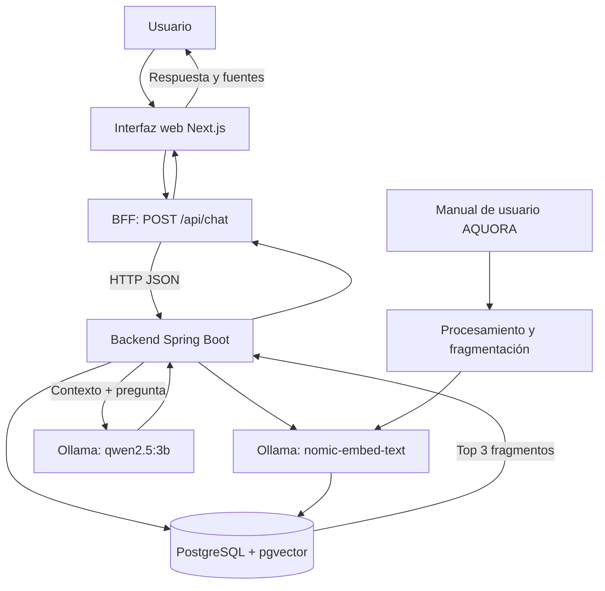

Nombre: Jesús Alberto Quintanilla Monzón
Carnet: 0905-21-9366
Repositorio: https://github.com/grupo2-stack1-fase2/fase2-feature2-chatbot-rag
Modulo asignado: Chatbot con RAG

# Chatbot con RAG — AQUORA

Módulo de consulta conversacional que utiliza **Retrieval-Augmented Generation (RAG)** para responder preguntas relacionadas con el manual de usuario de AQUORA. El sistema recupera fragmentos pertinentes del documento y los entrega como contexto al modelo generativo. La respuesta incluye referencias a las fuentes recuperadas.

> Este repositorio documenta el módulo asignado: Chatbot con RAG. La arquitectura integral de Fase 2 y la integración con los demás módulos se documentan en el repositorio o diagrama consolidado del equipo.

## 1. Objetivo y alcance

Permitir que una persona consulte información del manual de AQUORA en lenguaje natural, sin depender de una búsqueda manual dentro del documento.

El módulo realiza estas tareas:

- Recibe la pregunta desde la interfaz web.
- Convierte la consulta en un embedding.
- Busca fragmentos semánticamente similares en PostgreSQL con pgvector.
- Construye un contexto con los fragmentos recuperados.
- Solicita al modelo de lenguaje una respuesta basada en ese contexto.
- Devuelve la respuesta y los fragmentos fuente para apoyar la verificación.

El chatbot está orientado al contenido documental disponible. No consulta por sí mismo saldos, pagos personales ni información transaccional en tiempo real.

## 2. Arquitectura del módulo



### Componentes

| Componente | Responsabilidad |
|---|---|
| Interfaz web | Permite escribir preguntas y visualizar respuestas y fuentes. |
| BFF Next.js | Valida la pregunta recibida y reenvía la solicitud al backend RAG. |
| Backend Spring Boot | Coordina embeddings, recuperación de fragmentos y generación de respuesta. |
| Ollama — `nomic-embed-text` | Genera embeddings para las consultas y los fragmentos documentales. |
| PostgreSQL + pgvector | Almacena los fragmentos y sus vectores, y permite la búsqueda por similitud. |
| Ollama — `qwen2.5:3b` | Genera una respuesta a partir de la pregunta y del contexto recuperado. |
| Manual AQUORA | Fuente documental que se procesa para alimentar la base vectorial. |

## 3. Tecnologías

- **Backend:** Java 17, Spring Boot, Spring Web MVC, Spring JDBC y Maven.
- **Frontend/BFF:** Next.js, React y TypeScript.
- **Base de datos vectorial:** PostgreSQL con extensión pgvector.
- **Modelos locales:** Ollama, `nomic-embed-text` para embeddings y `qwen2.5:3b` para generación.
- **Procesamiento documental:** Apache PDFBox para lectura de documentos PDF.

Versiones declaradas por el proyecto: Spring Boot 4.1.1, Next.js 16.4.3, React 19.3.0 y PDFBox 3.0.6.

## 4. Flujo de funcionamiento

### Preparación del documento

1. Se carga el manual de usuario de AQUORA.
2. El backend extrae el texto y lo divide en fragmentos de hasta aproximadamente 1,000 caracteres, con un solapamiento de 150 caracteres.
3. Cada fragmento se convierte en un vector mediante `nomic-embed-text`.
4. Los fragmentos y sus embeddings se almacenan en la tabla `document_chunks` de PostgreSQL/pgvector.

### Consulta

1. El usuario escribe una pregunta en la interfaz.
2. Next.js recibe la solicitud en `POST /api/chat` y valida que `question` sea una cadena no vacía.
3. El BFF reenvía el cuerpo JSON a `POST /api/v1/chat` del backend Spring Boot.
4. El backend genera el embedding de la pregunta y recupera los tres fragmentos más similares.
5. Los fragmentos recuperados se agregan como contexto para el modelo `qwen2.5:3b`.
6. El backend devuelve la respuesta y las fuentes; el BFF entrega el resultado a la interfaz.

## 5. Configuración y ejecución local

### Requisitos previos

- Java 17 o compatible con la configuración del proyecto.
- Maven.
- Node.js y npm.
- PostgreSQL con pgvector habilitado y la tabla `document_chunks` creada según el esquema utilizado por el backend.
- Ollama instalado y ejecutándose localmente.
- Los modelos `nomic-embed-text` y `qwen2.5:3b` disponibles en Ollama.

El repositorio no incluye un script SQL de creación de la tabla. La base de datos debe estar preparada antes de iniciar el backend.

### Configuración del backend

El archivo `backend-rag/src/main/resources/application.properties` define los parámetros principales:

```properties
rag.embedding.url=http://localhost:11434
rag.embedding.model=nomic-embed-text
rag.generation.url=http://localhost:11434
rag.generation.model=qwen2.5:3b
server.port=8082

spring.datasource.url=${SPRING_DATASOURCE_URL}
spring.datasource.username=${SPRING_DATASOURCE_USERNAME}
spring.datasource.password=${SPRING_DATASOURCE_PASSWORD}
```

Configura las variables de entorno de conexión a PostgreSQL en tu entorno local. No escribas contraseñas ni credenciales directamente en archivos versionados.

### Iniciar Ollama

Asegúrate de que Ollama esté ejecutándose y descarga los modelos si todavía no están disponibles:

```bash
ollama pull nomic-embed-text
ollama pull qwen2.5:3b
```

### Iniciar el backend

Desde la carpeta `backend-rag`:

```bash
mvn spring-boot:run
```

El backend queda configurado para escuchar en el puerto `8082`.

### Iniciar el BFF y la interfaz

Desde la carpeta `bff-nextjs`:

```bash
npm install
npm run dev
```

El BFF utiliza `RAG_BACKEND_URL` para localizar el backend. Si no se define, utiliza `http://127.0.0.1:8082`.

Abre en el navegador la dirección local que Next.js indique en la terminal.

## 6. API

### BFF — `POST /api/chat`

Recibe una pregunta en formato JSON:

```json
{
  "question": "¿Para qué sirve la sección de clientes?"
}
```

El BFF valida que `question` exista y no esté vacía, y reenvía la solicitud al backend. Si el backend no responde correctamente, el BFF devuelve un error de pasarela (`502`).

### Backend — `POST /api/v1/chat`

Endpoint del servicio Spring Boot que procesa la consulta RAG. Recibe la pregunta y devuelve la respuesta generada junto con información de los fragmentos recuperados como fuentes.

## 7. Pruebas funcionales

Se realizaron consultas desde la interfaz para comprobar el flujo de pregunta, recuperación y respuesta con fuentes. Casos de prueba de referencia:

| Caso | Consulta de ejemplo | Resultado esperado |
|---|---|---|
| Información de AQUORA | ¿Qué es AQUORA? | Respuesta basada en el manual y fuentes recuperadas. |
| Sección del sistema | ¿Para qué es la sección de clientes? | Explicación sustentada por fragmentos del manual. |
| Facturación | ¿Qué pago en la factura? | Información documental pertinente, acompañada de fuentes. |
| Consulta fuera del alcance documental | ¿Cuál es mi saldo actual? | No debe inventar datos personales o transaccionales que no estén en el manual. |

Para repetir la prueba, inicia PostgreSQL, Ollama, el backend y la interfaz; después envía las preguntas desde la aplicación y verifica que se muestren las fuentes.

## 8. Decisión técnica

Se eligió una arquitectura RAG en lugar de depender únicamente de una respuesta generada por el modelo. La recuperación de fragmentos del manual aporta contexto específico de AQUORA y permite mostrar fuentes junto con la respuesta. PostgreSQL con pgvector mantiene los fragmentos y embeddings en el mismo motor de base de datos, mientras que Ollama permite ejecutar los modelos localmente.

## 9. Consideraciones

- La calidad de las respuestas depende de la cobertura y claridad del manual procesado.
- Las respuestas se basan en el contenido documental recuperado; no representan consultas a datos operativos en tiempo real.
- Las credenciales de base de datos deben mantenerse en variables de entorno y nunca publicarse en el repositorio.
- Los demás módulos de Fase 2 y el diagrama general integrado corresponden a la consolidación del equipo.
